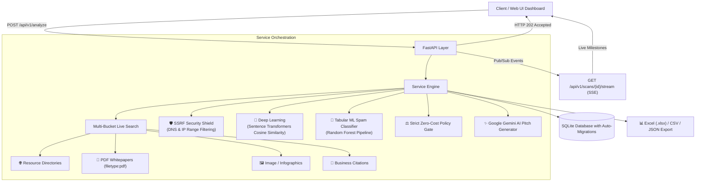

# 🚀 LinkIntel AI — Deep Learning Backlink Intelligence & AI Outreach Engine

[](https://www.python.org/)
[](https://github.com/mightyalok00/linkintel-ai-deep-learning/actions/workflows/ci.yml)
[](https://fastapi.tiangolo.com)
[](https://pytorch.org/)
[](https://scikit-learn.org/)
[](https://ai.google.dev/)
[](https://www.docker.com/)
[](tests/)
[](LICENSE)

An enterprise-grade, full-stack intelligence platform that discovers 100+ high-authority, verified-free backlink opportunities across multiple web formats, filters toxic links via machine learning, computes semantic topical relevance with PyTorch sentence embeddings, and crafts personalized outreach pitches using Google Gemini.

[Key Features](#-key-features) • [Architecture](#-system-architecture) • [Quick Start](#-quick-start) • [API Reference](#-api-reference) • [Machine Learning](#-machine-learning--ai-engine) • [Dashboard UI](#-interactive-dashboard)

---

## 🌟 Key Features

| Capability | Technical Implementation | Benefit |
| :--- | :--- | :--- |
| **Multi-Bucket Web Discovery** | Concurrently harvests 4 distinct web vectors: Resource Catalogs, Whitepapers (`filetype:pdf`), Infographics, and Business Citations. | Uncovers high-converting links overlooked by standard scrapers. |
| **Asynchronous Job Queue** | Non-blocking **HTTP 202 Accepted** dispatcher with **Server-Sent Events (SSE)** and status polling. | Fast UI response times without HTTP timeouts during heavy deep-scans. |
| **3-Tier AI / ML Pipeline** | Random Forest tabular spam scoring, Sentence-Transformers semantic cosine, and Google Gemini outreach pitch generation. | Triages opportunities by true editorial value, authority, and safety. |
| **Enterprise SSRF Shield** | Pre-flight DNS resolution checking target IPs against RFC 1918 private subnets, loopbacks, and cloud metadata. | Completely immune to internal network intrusion or SSRF attacks. |
| **Strict Zero-Cost Gate** | Algorithmic screening verifying 6 explicit cost conditions before awarding `verified_free` status. | Prevents wasted time pitching link farms or surprise paywalls. |
| **Live Link Verification** | Real-time HTTP header and HTML DOM inspection verifying backlink reachability, `dofollow` status, and `noindex` robots tags. | Eliminates broken or unindexed opportunities. |
| **Multi-Format Exports** | Professional formatted **Excel (.xlsx)** workbooks with link pills, plus clean **CSV** and **JSON** APIs. | Directly compatible with BuzzStream, Lemlist, Pitchbox, or Excel. |
| **Glassmorphic Web UI** | Ultra-responsive, zero-dependency vanilla CSS frontend with animated live progress indicators. | Sub-100ms load times with modern aesthetics. |

---

## 🏛 System Architecture



---

## 📦 Multi-Bucket Discovery Vectors

Most traditional SEO scrapers only seek plain blog posts. LinkIntel AI harvests across 4 distinct, high-impact backlink categories:

1. **🌐 Resource Directories**: Verified web catalogs, educational hubs, and industry-curated tool lists that accept organic site submissions.
2. **📄 PDF Documents (`filetype:pdf`)**: Academic whitepapers, university reading lists, government resources, and research guides where inclusion yields top-tier Google trust.
3. **🖼️ Visual & Infographics**: Media hubs and photo catalogs that accept infographics and diagrams with embed attribution backlinks.
4. **🏢 Niche Business Citations**: High-authority business directories and professional registers that improve Google Local Map Pack rankings.

---

## 🚀 Quick Start

### Option 1: Docker (Recommended for Cloud & Production)

Deploy anywhere in the world in a single command:

```bash
# 1. Clone repository
git clone https://github.com/mightyalok00/linkintel-ai-deep-learning.git
cd linkintel-ai-deep-learning

# 2. Configure environment
cp .env.example .env
# Add your GEMINI_API_KEY to .env

# 3. Launch container
docker compose up -d --build
```

The application will be live at **`http://localhost:8000/`**.

### Option 2: Local Python Setup (PowerShell / Bash)

**Requirements**: Python 3.12+

```powershell
# 1. Clone and enter directory
git clone https://github.com/mightyalok00/linkintel-ai-deep-learning.git
cd linkintel-ai-deep-learning

# 2. Create and activate virtual environment
py -3.12 -m venv .venv
.\.venv\Scripts\Activate.ps1

# 3. Install dependencies
pip install --upgrade pip
pip install -r requirements.txt

# 4. Copy environment configuration
cp .env.example .env

# 5. Launch the server
uvicorn app.main:app --host 0.0.0.0 --port 8000 --reload
```

- **Interactive Dashboard**: `http://localhost:8000/`
- **Interactive Swagger Docs**: `http://localhost:8000/docs`

---

## 🧪 Testing & Verification

The project includes an automated test suite verifying scoring mathematics, security boundaries, asynchronous lifecycles, and machine learning inference:

```powershell
pytest -v
```

```text
tests/test_api.py ........                                [ 28%]
tests/test_scoring.py .......                             [ 53%]
tests/test_security.py .............                      [100%]
====================== 28 passed in 5.85s ======================
```

---

## 📊 Interactive Dashboard

The mounted frontend delivers an interface designed without bloated JavaScript frameworks:

- **Niche Presets**: Instant configuration for Software/SaaS, Physiotherapy, E-commerce, Real Estate, Legal, Finance, and Marketing.
- **Region Scope Selector**: Target `Worldwide / Global` or localized markets (`US`, `UK`, `CA`, `AU`, `IN`, `DE`, `FR`, `SG`, `AE`, `JP`, `BR`).
- **Live Progress Monitor**: Animated SSE visualizer reporting search progress, semantic vectorization, and ranking milestones.
- **Link Filter Pills**: Instant client-side filtering by format (`📄 PDF`, `🖼️ Image`, `🌐 Directory`, `✓ Verified Free`).
- **AI Strategy Modal**: 1-click generation of tailored webmaster pitches, subject lines, and value propositions powered by Google Gemini.
- **One-Click Excel Download**: Clean `.xlsx` workbooks ready for agency outreach pipelines.

---

## 🔌 API Reference

### 1. Initiate Backlink Scan (Asynchronous)

`POST /api/v1/analyze?sync=false`

```json
{
  "website_url": "https://example.com",
  "category": "software",
  "country": "GLOBAL",
  "keywords": ["developer tools", "open source"],
  "provider": "live_search",
  "target_count": 100,
  "use_deep_learning": false,
  "sync": false
}
```

**Response (`202 Accepted`):**

```json
{
  "scan_id": "9d8e7c6b-5a4f-3e2d-1c0b-a9b8c7d6e5f4",
  "status": "queued",
  "progress": 0,
  "stage": "Scan queued for execution",
  "message": "Scan job queued successfully.",
  "stream_url": "/api/v1/scans/9d8e7c6b-5a4f-3e2d-1c0b-a9b8c7d6e5f4/stream",
  "status_url": "/api/v1/scans/9d8e7c6b-5a4f-3e2d-1c0b-a9b8c7d6e5f4/status"
}
```

### 2. Live SSE Progress Stream

`GET /api/v1/scans/{scan_id}/stream`

Returns a real-time `text/event-stream` stream:

```text
data: {"scan_id": "...", "status": "discovering", "progress": 25, "stage": "Dispatching 12 search workers...", "found_count": 0}
data: {"scan_id": "...", "status": "discovering", "progress": 65, "stage": "Extracted 74 live candidate opportunities.", "found_count": 74}
data: {"scan_id": "...", "status": "scoring", "progress": 88, "stage": "Evaluating spam risk & cost policy...", "found_count": 74}
data: {"scan_id": "...", "status": "completed", "progress": 100, "stage": "Scan completed successfully", "found_count": 74}
```

### 3. Export to Excel (.xlsx)

`GET /api/v1/export/xlsx/{scan_id}`

Downloads a formatted spreadsheet with domain authority, URL links, link types, cost statuses, and metric breakdowns.

### 4. AI Pitch & Outreach Strategy

`POST /api/v1/prospects/explain`

```json
{
  "domain": "curated-dev-resources.org",
  "category": "software",
  "evidence": {
    "title": "Best Developer Tools Directory",
    "description": "Curated tools and libraries for modern developers."
  }
}
```

### 5. Live Backlink Reachability Check

`POST /api/v1/backlinks/check`

```json
{
  "urls": ["https://partner-catalog.org/resources"],
  "target_domain": "mysite.com"
}
```

---

## 🧠 Machine Learning & AI Engine

### Random Forest Spam Classifier

The link quality engine evaluates toxic link probability using an enterprise-grade scikit-learn pipeline (`Median Imputer` $\to$ `Standard Scaler` $\to$ `Balanced Random Forest Classifier`).

- **Features Analyzed & Relative Importance**:
  - `outbound_link_ratio` (**41.0%**): Outbound link density flags link farms and directory spam.
  - `thin_content_ratio` (**23.2%**): Ratio of low-word-count or scraped doorway pages.
  - `referring_domains` (**15.5%**): Root domain link equity volume.
  - `anchor_diversity` (**9.8%**): Commercial over-optimization vs. natural brand anchors.
  - `content_relevance` (**8.1%**): Semantic cosine similarity to seed keywords.
  - `domain_age_years` (**2.3%**): Registration age (flags volatile burner domains).

### Independent Benchmark & 5-Fold Cross-Validation

Trained and evaluated on **3,000 balanced observations** (`data/labeled_backlinks.csv`) with realistically modeled edge cases (fresh startups, expired PBN networks, and directory hubs) and an empirical 5% annotator disagreement rate:

| Model | Architecture | Test ROC-AUC | Macro F1 | Precision | Recall | 5-Fold CV AUC |
| :--- | :--- | :---: | :---: | :---: | :---: | :---: |
| **Dummy Baseline (Prior)** | Most Frequent Class | 0.5000 | 0.3333 | 0.0000 | 0.0000 | $0.5000 \pm 0.00$ |
| **Dummy Baseline (Stratified)** | Uniform Random | 0.5200 | 0.5198 | 0.5208 | 0.5000 | $0.5008 \pm 0.02$ |
| **Linear Baseline** | Logistic Regression (L2) | 0.9567 | 0.9517 | 0.9502 | 0.9533 | $0.9636 \pm 0.01$ |
| **LinkIntel Production Model** | **Random Forest (300 trees)** | **0.9567** | **0.9550** | **0.9535** | **0.9567** | **0.9577 ± 0.01** |

> Complete dataset provenance, feature schemas, and synthesis methodology are documented in [`data/README.md`](data/README.md).

To reproduce benchmarks or retrain the production model:

```powershell
python -m app.ml.train_spam_model --input data/labeled_backlinks.csv --output models/spam_risk.joblib
```

---

## 🔍 Candidate Discovery vs. Verified Opportunities

LinkIntel AI maintains strict editorial boundaries between raw search findings and verified placements:

1. **Candidate Discovery (`candidate_unverified`)**:
   - Harvested live from search result snippets, document repositories, and citation databases.
   - Cost fields default to `pending_verification` until verified. Search snippets mentioning "free" are never treated as proven placements.
2. **Editorial Verification (`editorial_verified_free` / `editorial_verified_paid`)**:
   - Requires explicit confirmation of zero fees (`placement_fee == 0`, `submission_fee == 0`), absence of mandatory purchases or paid plans, and verified submission terms (`terms_verified == true`).
   - Every opportunity payload records metric provenance (`metric_provenance`), evaluation timestamps (`last_checked`, `evaluated_at`), and transparent ranking rationale.

---

## 🛡️ Enterprise SSRF & Adversarial Network Defense

All outbound HTTP inspection routes (`check_backlinks`) use `safe_fetch_url` with multi-hop verification:

- **Pre-Flight DNS & Network Resolution**: Validates that all candidate domains and direct IP literals are public before opening a socket connection.
- **Per-Hop Redirect Defense**: Inspects HTTP `301`, `302`, `303`, `307`, and `308` `Location` headers before following redirects, completely blocking DNS rebinding and internal redirection attacks.
- **Restricted Network Enforcement**: Blocks RFC 1918 private subnets (`10.0.0.0/8`, `172.16.0.0/12`, `192.168.0.0/16`), Carrier-Grade NAT (`100.64.0.0/10`), Cloud Metadata (`169.254.169.254`), Loopback (`127.0.0.0/8`, `::1`), IPv6 Unique Local (`fc00::/7`), IPv6 Link-Local (`fe80::/10`), Unspecified (`0.0.0.0`, `::`), and Benchmarking ranges (`198.18.0.0/15`).
- **Comprehensive Adversarial Tests**: Tested against redirect chains, cloud metadata exfiltration, loopback probes, and redirect loops (`tests/test_security.py`).

---

## 📂 Repository Structure

```text
linkintel-ai-deep-learning/
├── .github/
│   └── workflows/
│       └── ci.yml            # Matrix CI (Python 3.11 & 3.12, ruff lint, pytest, ML validation)
├── app/
│   ├── deep_learning/        # Batch Sentence Transformers embeddings (relevance.py)
│   ├── genai/                # Google Gemini GenAI outreach engine (gemini.py, ollama.py)
│   ├── ml/                   # Random Forest spam classifier pipeline (features.py, spam_model.py)
│   ├── providers/            # Multi-bucket search engine & CSV/demo adapters
│   ├── static/               # Glassmorphic UI dashboard (index.html, styles.css, app.js)
│   ├── config.py             # Global settings with host/port binding
│   ├── db.py                 # SQLite persistence with auto-migration
│   ├── main.py               # FastAPI server, SSE stream, 202 async jobs, Excel export
│   ├── schemas.py            # Pydantic models & multi-region country scope
│   ├── scoring.py            # Free-cost gate & transparent ranking engine
│   └── security.py           # Multi-hop SSRF protection, restricted IP filtering, safe_fetch_url
├── data/
│   ├── README.md             # Dataset provenance, feature definitions, and baseline methodology
│   └── labeled_backlinks.csv # 3,000-sample balanced training dataset with calibrated noise
├── models/
│   └── spam_risk.joblib      # Trained & validated production ML spam classifier
├── tests/
│   ├── test_api.py           # Async 202 lifecycle, status polling, and Excel tests
│   ├── test_scoring.py       # ML spam-risk inference & scoring tests
│   └── test_security.py      # Adversarial SSRF, CGNAT, IPv6, and redirect tests (55 passed)
├── .env.example              # Template environment configuration
├── .gitignore                # Source control ignore rules
├── Dockerfile                # Multi-stage production cloud container image
├── docker-compose.yml        # 1-command deployment with volume persistence
├── pyproject.toml            # PEP 621 packaging, pytest & ruff configuration
├── README.md                 # Complete system documentation & architecture guide
├── requirements.txt          # Production application dependencies
└── requirements-ml.txt       # Optional PyTorch & Sentence-Transformers dependencies
```

---

## 📄 License

This project is licensed under the [MIT License](LICENSE).
